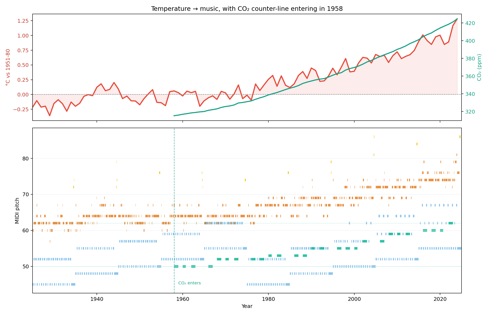

# One Hundred Years of Warming — a climate duet

**NASA GISTEMP v4 monthly temperature (1925–2024) × NOAA Mauna Loa CO₂**
mapped to ABC notation, MIDI, audio, and a browser player.



## What is in here

| file | what it is |
|---|---|
| `warming.abc` | the score: 4 voices, 12/8, 100 bars |
| `warming.mid` | MIDI render (flute, cello, bassoon, glockenspiel) |
| `warming.mp3` | 4:44 audio render, 96 kbps |
| `warming.wav` | lossless render, 22.05 kHz stereo |
| `warming.png` | temperature + CO₂ curves and a 4-voice piano roll |
| `player.html` | the web player: Tone.js + year slider + animated curves |
| `player.css` / `player.js` | player styling and audio/visual logic |
| `player_data.js` | the score as JSON (generated by `sonify.py`) |
| `tone.js` | vendored Tone.js 14.8.49, so the player works offline |
| `sonify.py` | the pipeline: data → form → ABC / MIDI / JSON / PNG |
| `gistemp.csv` | NASA GISTEMP v4 snapshot |
| `co2_mm_mlo.csv` | NOAA Mauna Loa CO₂ snapshot |

## The three additions

### 1. CO₂ counterpoint

Mauna Loa CO₂ starts in 1958. It enters as a **slow counter-line**, not as a
second copy of the temperature melody:

- annual mean of the deseasonalized monthly CO₂ → **D Dorian**, D3–D4
- one long note every two years (one bar on, one bar off)
- note lengths breathe: 12, 9, 12, 6, 12 eighths, then the decade cadence
- bassoon timbre in the MIDI; AMSynth pad in the browser
- it is deliberately **lower and slower** than the temperature line, so the two
  voices are heard as a duet rather than a unison

D Dorian shares the natural notes of A minor, so the counter-line can use F and
B without leaving the key. The result is a slow, inevitable ascent from D3 to
D4 while the temperature melody moves above it.

### 2. Web player

Open `player.html` via a local server:

```bash
python3 -m http.server 8765
# then open http://localhost:8765/player.html
```

The player has:

- play / pause, space-bar shortcut
- a year slider that seeks through 1925–2024
- a moving playhead on both the temperature/CO₂ chart and the piano roll
- live readout: year, temperature anomaly, CO₂ ppm, current tempo
- four voice toggles (temperature, bass, CO₂, motif)
- click the chart to seek
- no network required: Tone.js and the score data are local files

Audio is built with Tone.js `Part`s scheduled in **absolute seconds** from the
same JSON event list that generates the ABC and MIDI. Seeking sets
`Tone.Transport.seconds`, so the audio, playhead, and readout stay in sync.

### 3. Musical form

The piece is now organised in **10-bar decades**, not a flat stream of months:

```
bar 1 ─ 4   temperature phrase
bar 4       breath rest on beat 3 (z3)
bar 5 ─ 8   temperature phrase
bar 8       breath rest on beat 3 (z3)
bar 9       temperature continues
bar 10      cadence: long note (6 eighths) + 3-note glockenspiel motif
            bass: root whole-note; CO₂: rest
```

- **Breath rests** at bars 4 and 8 carve a real silence into the melody; the
  bass keeps the pulse, so the phrase sounds like a singer breathing.
- **Cadence** at bar 10 replaces the last year of monthly data with a long note
  on the decade mean. The lost bar is the price of a cadence; it is worth it.
- **Decade motif** at bar 10 is the first three months of that decade, transposed
  up an octave and played on glockenspiel. It gives each decade a name.
- **Syncopated bass**: even decades use onsets 0, 3, 6, 8; odd decades use
  0, 4, 6, 9 (a one-eighth hole before the fifth). The 2+4 ending pushes into
  the next bar instead of marking time.

## Mapping

| data | musical parameter | rule |
|---|---|---|
| monthly temperature anomaly | **pitch** | −0.6…+1.5 °C → 10 degrees of A-minor pentatonic, A3…A5 |
| month-to-month change | **rhythm** | > 0.22 °C: split the slot into two 16ths; < 0.06 °C: hold 2–3 eighths |
| decadal mean volatility | **tempo** | 68–112 dotted-quarter BPM, one tempo per decade |
| anomaly | **dynamics** | MIDI velocity 45–118; `!p!` … `!ff!` per decade |
| decade index | **bass root** | A2 → C3 → D3 → E3 → G3, cycling every 10 years |
| CO₂ annual mean | **counter-line pitch** | 315–425 ppm → D Dorian D3–D4 |
| year | **bar** | 12/8, 12 eighth-note slots = 12 months |
| decade | **phrase** | 10 bars, breath rests, cadence, 3-note motif |

Why these choices:

- **Pentatonic temperature line** means the data can jump without producing
  accidents; no accidentals are needed in the ABC.
- **Pitch maps level, rhythm maps volatility.** If both map the same feature you
  get a siren, not a piece.
- **Tempo changes per decade, not per month.** Monthly tempo changes sound like
  a broken tape; decade-level changes read as urgency.
- **Hold notes during calm months.** Stable climate = long tones; unstable
  months = 16th-note flurries. That is phrasing, not just mapping.
- **Slow bass.** A syncopated root/fifth/octave pattern gives the ear a floor
  while the melody does the data work.

## Run the pipeline

```bash
python3 sonify.py --start 1925 --end 2024 --out warming
```

This regenerates `warming.abc`, `warming.mid`, `warming.png`, `player_data.js`,
and (if `fluidsynth` + a GM soundfont are installed) `warming.wav`.

Dependencies: `mido`, `matplotlib`; audio: `fluidsynth` and
`/usr/share/sounds/sf2/FluidR3_GM.sf2`.

ABC can be opened in EasyABC, abcjs, or converted with
`abc2midi warming.abc -o warming.mid`. The ABC has four voices:

```
V:1 Temperature (flute)      V:3 CO2 (bassoon)
V:2 Bass (cello)            V:4 Decade motif (glockenspiel)
```

## Design notes / caveats

- This is **sonification with musical constraints**, not an analytical tool.
  The ear is good at hearing change, bad at reading exact values.
- The temperature pitch range is deliberately two octaves; extremes are clamped.
- The CO₂ voice starts in 1958 because that is when the Mauna Loa record starts.
  Before that the listener hears temperature alone — which is itself the point.
- The cadence bar replaces one year of monthly detail per decade. The JSON still
  contains the underlying series, so the player can show the data even where the
  music chooses a cadence.
- The tempo map follows decadal volatility, so it is not monotonic with time:
  the 1970s are faster than the 1980s because their month-to-month swings were
  larger.

## Data

- NASA GISS, **GISTEMP v4**, global land-ocean temperature anomalies:
  https://data.giss.nasa.gov/gistemp/tabledata_v4/GLB.Ts+dSST.csv (public domain)
- NOAA GML, **Mauna Loa CO₂** monthly mean, deseasonalized:
  https://gml.noaa.gov/webdata/ccgg/trends/co2/co2_mm_mlo.csv (public domain)

## Next

- Add a second city / hemisphere as a counter-melody.
- Map climate velocity (rate of change) to articulation instead of tempo.
- Export a video with the playhead and curve for social.
- Try a string quartet arrangement: the four voices already map to a quartet.
